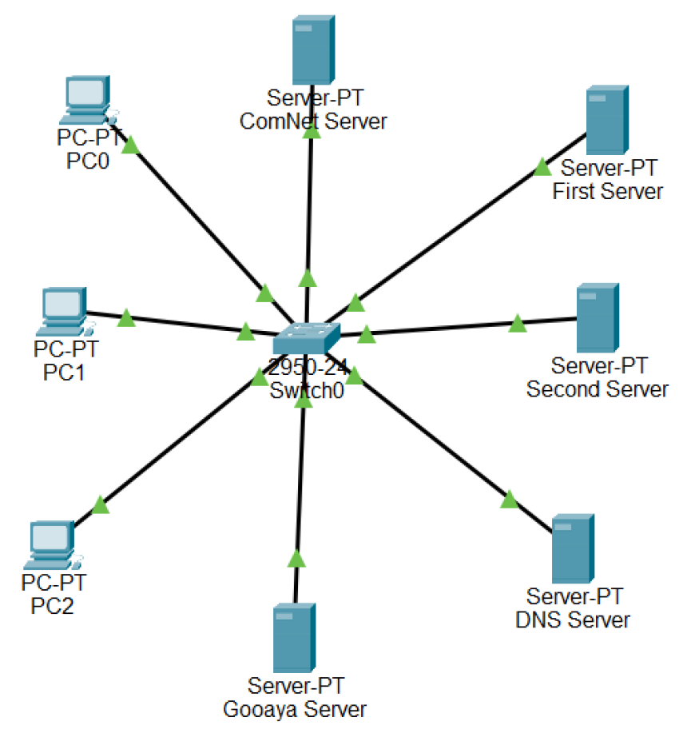
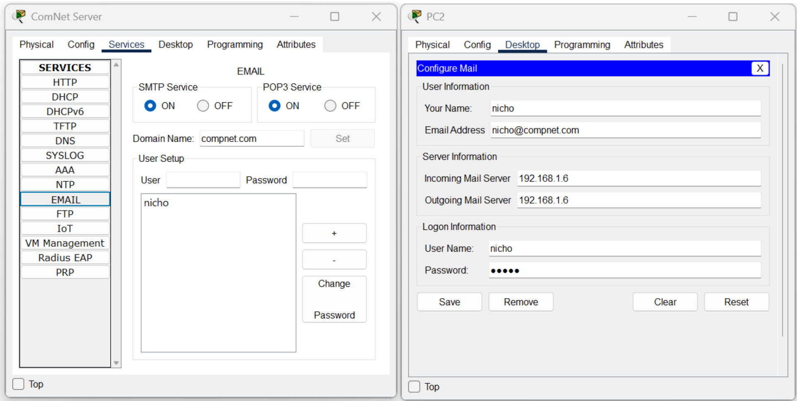
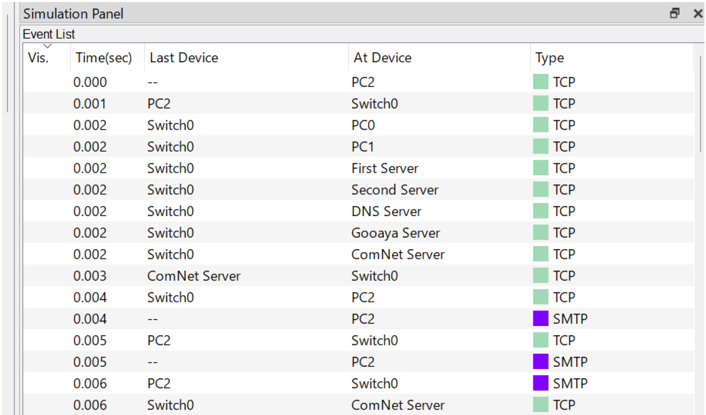
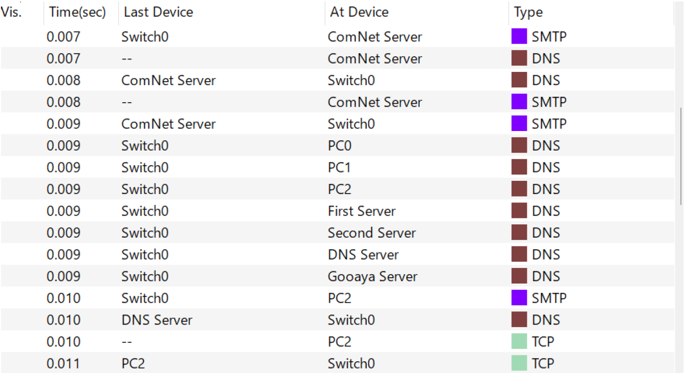
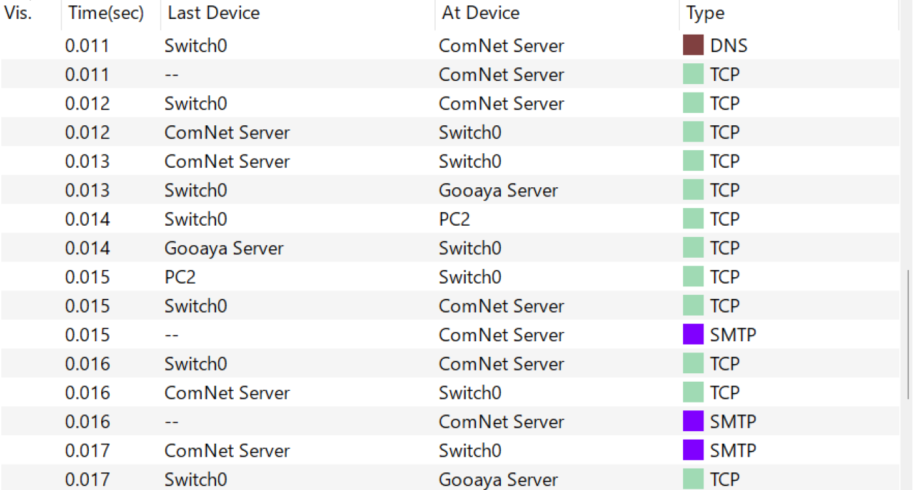
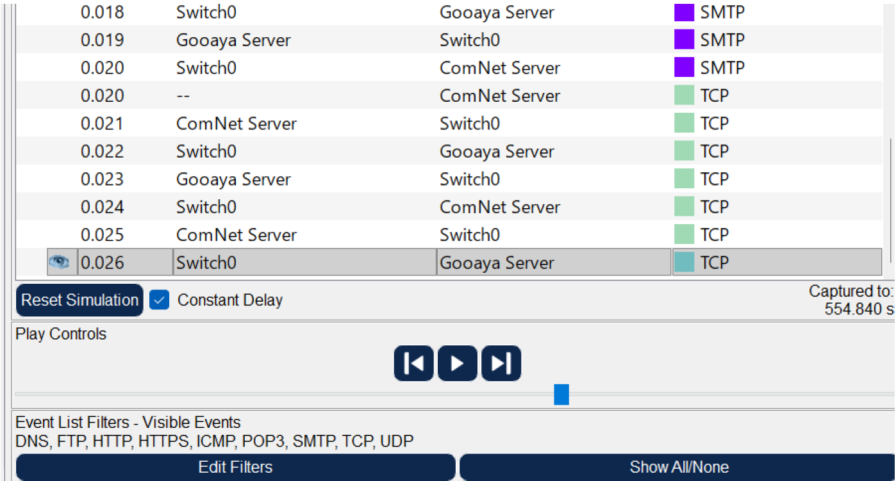
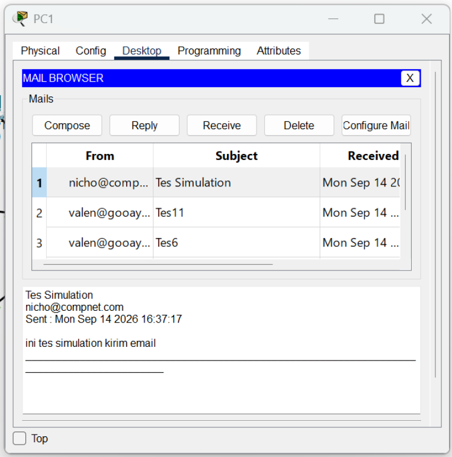

# 📧 Cross-Domain Email Server Simulation — Cisco Packet Tracer

This repository documents the design, configuration, and protocol-level packet analysis of a **cross-domain Email Server infrastructure** built in **Cisco Packet Tracer**. The simulation examines how clients and servers communicate using **TCP**, **DNS**, **SMTP**, and **POP3** during outbound and inbound email transactions across separate domains (`compnet.com` to `gooaya.com`).

---

## 📋 Table of Contents
- [Project Objectives](#-project-objectives)
- [Network Architecture & Topology](#-network-architecture--topology)
- [IP Addressing & Service Configuration](#-ip-addressing--service-configuration)
- [Packet Flow Analysis (Simulation Mode)](#-packet-flow-analysis-simulation-mode)
  - [1. Outbound Email Flow (SMTP & DNS)](#1-outbound-email-flow-smtp--dns)
  - [2. Inbound Email Flow (POP3)](#2-inbound-email-flow-pop3)
- [Verification Results](#-verification-results)

---

## 🎯 Project Objectives
1. Deploy and integrate a new Email Server node (`ComNet Server`) into a switch-based local area network using a star topology.
2. Configure **SMTP** (*Simple Mail Transfer Protocol*) and **POP3** (*Post Office Protocol v3*) services along with user mailbox accounts on the mail server.
3. Analyze real-time packet exchanges in **Simulation Mode**, tracing TCP handshakes, **DNS** domain lookups, inter-server **SMTP** mail relaying, and **POP3** client retrieval.

---

## 🌐 Network Architecture & Topology

The local network uses a star topology centered on a **Cisco Catalyst 2950-24 (`Switch0`)** connecting all client workstations and dedicated servers:

- **End Devices (Clients):** `PC0`, `PC1` (recipient client), and `PC2` (sender client).
- **Dedicated Servers:**
  - `ComNet Server`: Primary Email Server hosting the `compnet.com` domain.
  - `Gooaya Server`: Destination Email Server hosting the `gooaya.com` domain.
  - `DNS Server`: Domain Name System server resolving domain names to their corresponding IPv4 addresses.
  - `First Server` & `Second Server`: Supporting local network infrastructure servers.



---

## ⚙️ IP Addressing & Service Configuration

### 1. Server Configuration

| Device Name | Service Role | IPv4 Address | Subnet Mask | Domain / Active Services |
| :--- | :--- | :---: | :---: | :--- |
| **ComNet Server** | Email Server (Source) | `192.168.1.6` | `255.255.255.0` | Domain: `compnet.com` (`SMTP`: ON, `POP3`: ON) |
| **Gooaya Server** | Email Server (Destination) | `192.168.1.5` | `255.255.255.0` | Domain: `gooaya.com` (`SMTP`: ON, `POP3`: ON) |
| **DNS Server** | Name Resolution | — | — | `DNS`: ON (A-records for `compnet.com` & `gooaya.com`) |



### 2. Mail Client Configuration

| Device | Username | Email Address | Incoming Mail Server | Outgoing Mail Server |
| :--- | :---: | :--- | :---: | :---: |
| **PC2 (Sender)** | `nicho` | `nicho@compnet.com` | `192.168.1.6` | `192.168.1.6` |
| **PC1 (Recipient)** | `miau` | `miau@gooaya.com` | `192.168.1.5` | `192.168.1.5` |

---

## 🔍 Packet Flow Analysis (Simulation Mode)

Testing was conducted by composing and sending an email from `nicho@compnet.com` (`PC2`) to `miau@gooaya.com` (`PC1`) with the subject **`Tes Simulation`**.

### 1. Outbound Email Flow (SMTP & DNS)

The end-to-end transmission from `PC2` through `ComNet Server` to `Gooaya Server` takes place between **`0.000s` and `0.026s`**:

1. **Initial Connection Setup / TCP Handshake (`0.000s – 0.004s`):**
   - `PC2` initiates a `TCP` session through `Switch0`.
   - `ComNet Server` responds via `Switch0` to complete the 3-way handshake.
2. **Domain Name Resolution via DNS (`0.007s – 0.011s`):**
   - Because the recipient belongs to an external domain (`gooaya.com`), `ComNet Server` sends a `DNS` query through `Switch0` to `DNS Server`.
   - `DNS Server` replies with the resolved destination IP address (`192.168.1.5`).
3. **Message Transfer & Relay via SMTP (`0.004s – 0.020s`):**
   - `PC2` transmits the email payload to `ComNet Server` over `SMTP`.
   - Acting as a *Mail Transfer Agent (MTA)*, `ComNet Server` relays the `SMTP` message through `Switch0` to `Gooaya Server`.
4. **TCP Connection Teardown (`0.020s – 0.026s`):**
   - Once the SMTP transaction completes, `ComNet Server`, `Gooaya Server`, and `PC2` exchange closing `TCP` packets to terminate the session cleanly.






### 2. Inbound Email Flow (POP3)

After clearing the event list, message retrieval was initiated on `PC1` by clicking **Receive** in the Mail Browser, spanning **`0.000s` to `0.015s`**:

1. **TCP Handshake (`0.000s – 0.004s`):**
   - `PC1` sends a `TCP` connection request through `Switch0` to `Gooaya Server` (`192.168.1.5`), which replies to establish the session.
2. **Mailbox Retrieval via POP3 (`0.004s – 0.009s`):**
   - `PC1` invokes **POP3** to request unread messages from `Gooaya Server`.
   - `Gooaya Server` authenticates the request and transmits the email data back to `PC1` via `Switch0`.
3. **Acknowledgment & Session Teardown (`0.009s – 0.015s`):**
   - `PC1` and `Gooaya Server` exchange final `TCP` acknowledgment (`ACK`) and termination packets to close the download session.

---

## ✅ Verification Results

| Test Case | Test Parameter | Observed Result |
| :--- | :--- | :--- |
| **Mailbox Provisioning** | User `nicho` on `ComNet Server` (`compnet.com`) | Account saved and authenticated successfully on `PC2`. |
| **Cross-Domain Delivery** | `nicho@compnet.com` ➔ `miau@gooaya.com` | DNS lookup resolved `gooaya.com` and SMTP relayed the message with zero packet loss. |
| **Client Mail Retrieval** | Click `Receive` in `PC1` Mail Browser | Email with subject **`Tes Simulation`** and body **`ini tes simulation kirim email`** appeared in `PC1`'s inbox. |



### Sample Received Message (`PC1`)
```text
From    : nicho@compnet.com
Subject : Tes Simulation
Sent    : Mon Sep 14 2026 16:37:17
Message : ini tes simulation kirim email
```

---

📂 **Cisco Packet Tracer File:** [Download Simulation (.pkt)](simulation/Cross_Domain_Email_Simulation.pkt)
